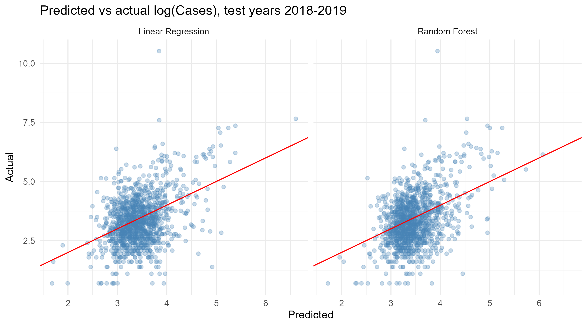
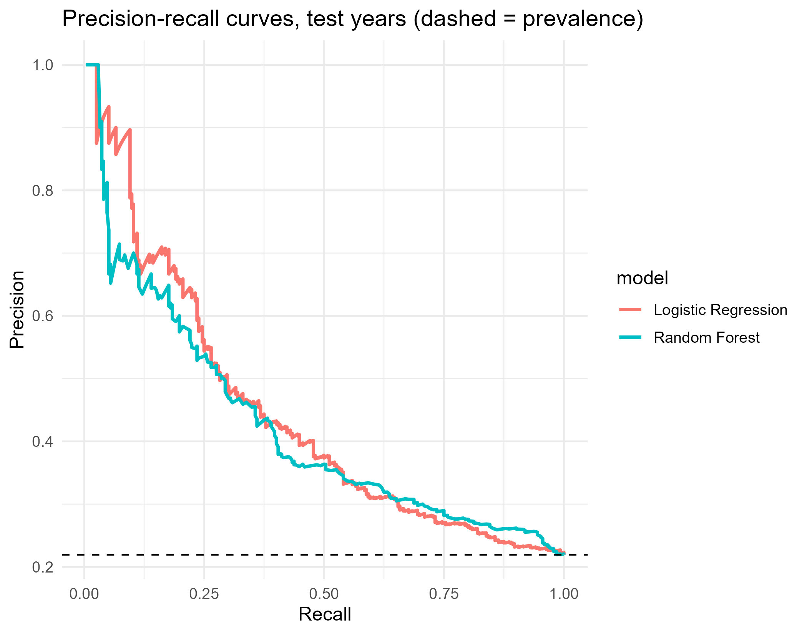
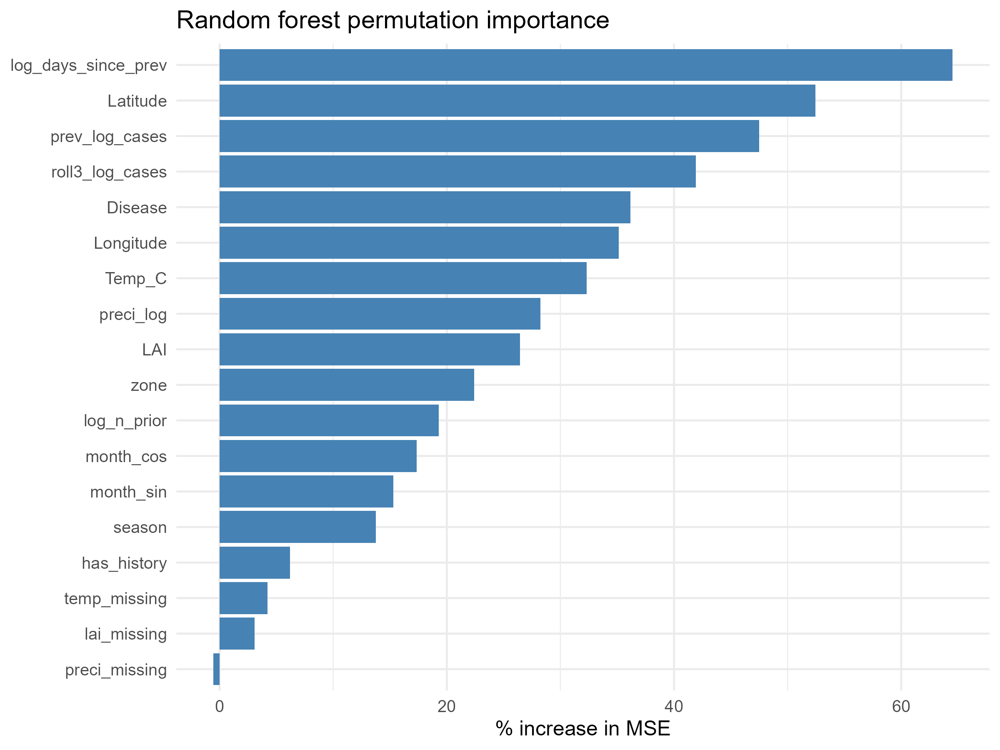
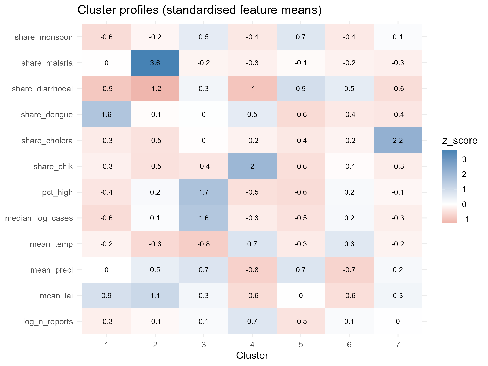

# Predicting Disease Outbreaks and Identifying the Factors Behind Case Surges

*What makes some disease outbreaks in India much larger than others, and can climate, location, season and history help us tell in advance?*

An end-to-end data science project in **R** that analyses district-level outbreak reports from India, combined with climate data, using regression, classification and clustering. Built as a college project in Artificial Intelligence and Data Science.

---

## Table of contents

1. [Why this project](#why-this-project)
2. [An honest note about the data](#an-honest-note-about-the-data)
3. [Research questions](#research-questions)
4. [The dataset](#the-dataset)
5. [Approach](#approach)
6. [Repository structure](#repository-structure)
7. [Getting started](#getting-started)
8. [Key design decisions](#key-design-decisions)
9. [Results](#results)
10. [Limitations](#limitations)
11. [Lessons learned](#lessons-learned)
12. [Reproducibility and version control](#reproducibility-and-version-control)

---

## Why this project

Every year, outbreaks of diarrhoeal disease, dengue, chikungunya, cholera and malaria hit districts across India. Some stay small. Others grow into large events that overwhelm local health systems. Public health teams constantly ask the same question: *Is this going to be a big one?*

Climate is often blamed. Heavy rain, warm temperatures, and green vegetation are all linked to mosquito-borne and water-borne diseases. But how strong is that link when you test it on real district-level reports? And how much of an outbreak's size can be explained by something much simpler, like what happened in the same district last time?

I wanted to answer these questions with data instead of assumptions, and to do it in a way that is **reproducible, leakage-free, and honest about its limits**.

## An honest note about the data

The EpiClim dataset records **outbreaks that were reported**. A row exists only when an outbreak happened and was recorded. It is not a week-by-week surveillance series with a value for every district in every week.

That shapes what this project can and cannot claim:

- **It can** study what makes a *reported* outbreak large, and what separates large outbreaks from small ones for the same disease.
- **It cannot** forecast whether an outbreak will occur in a given district next week, because the data says nothing about the weeks and places where nothing was reported.

I started with the wider framing ("predict future surges") and changed it once I looked at the data. Most districts have only a handful of records over 14 years, so week-ahead forecasting was never realistic. Wording the project to match what the data supports is part of doing the analysis properly.

## Research questions

1. **Patterns:** How do reported outbreaks vary across time, place, and disease? Is there seasonality?
2. **Size prediction:** Can we predict the size of a reported outbreak (log of case counts)?
3. **Surge prediction:** Can we predict whether an outbreak is *unusually large for its disease*?
4. **Factors:** Which variables are most associated with large outbreaks: previous case counts, temperature, precipitation, season, disease, location?
5. **Structure:** Do districts group into meaningful profiles (K-Means)?

## The dataset

| Item | Detail |
|------|--------|
| Source | EpiClim: outbreak reports from India with matching climate variables (*add the dataset's citation and link here*) |
| Raw size | 8,985 rows, 15 columns (8,970 records after cleaning) |
| Period | 2009 to 2022 |
| Coverage | 36 states and union territories, hundreds of districts |
| Diseases | 22 raw labels, standardised to 8 groups; the 4 records left in "Other" were dropped, leaving 7 modelled groups (Acute Diarrhoeal Disease, Dengue, Chikungunya, Cholera, Malaria, Acute Encephalitis Syndrome, Dengue and Chikungunya) |
| Outcomes | Reported cases and deaths |
| Climate | Temperature (Kelvin in the raw file), precipitation, leaf area index (LAI) |

> **Data files:** the raw CSV is not guaranteed to be redistributable. Download EpiClim from its original source and place it at `data/raw/EpiClim.csv`. Check its licence before committing it to a public repository.

## Approach

```
EpiClim raw data
      |
Cleaning  ->  Feature engineering (train-only statistics)
      |
Exploratory analysis  ->  Statistical analysis
      |
 +----+------------------------------+
 |                                   |
Regression                    Classification
(log cases)                   (high outbreak or not)
 |  Linear Regression          |  Logistic Regression
 |  Random Forest              |  Random Forest
 +----------------+------------+
                  |
     Model evaluation + factor importance
                  |
     K-Means clustering
     (association rules: planned, not completed)
                  |
          Final interpretation
```

**How I defined a "surge":** a reported outbreak counts as a high outbreak if its case count is above the **75th percentile for its own disease**, calculated from the training years only. Diseases differ a lot in typical size, so a single global threshold would just flag the most common diseases.

**How I split the data:** by time, never at random.

| Set | Years | Role |
|-----|-------|------|
| Train | 2009 to 2017 | Fit models, tune settings, compute thresholds and imputation values |
| Test | 2018 to 2019 | Final, untouched evaluation |
| Stress | 2020 to 2022 | Separate robustness check (sparse, COVID-era reporting) |

**What the models see:** disease, season, zone, coordinates, temperature, precipitation, vegetation, month, and **history features** built only from earlier reports of the same district and disease (previous size, rolling average, days since the last report, number of prior reports).

**What counts as a good result:** every model is compared against simple baselines, such as the disease median for regression and "was the last report in this district large?" for classification. A model that cannot beat a one-line rule has not learned anything useful, and I report that plainly.

## Repository structure

```
Predicting_Disease_Outbreaks/
├── Predicting_Disease_Outbreaks.Rproj
├── data/
│   ├── raw/            
│   ├── processed/     
│   └── final/         
├── R/
│   ├── 01_data_loading.R
│   ├── 02_data_understanding.R
│   ├── 03_data_cleaning.R
│   ├── 04_data_transformation.R      (superseded by 06)
│   ├── 05_eda.R
│   ├── 06_feature_engineering.R
│   ├── 07_statistical_analysis.R
│   ├── 08_regression.R
│   ├── 09_classification.R
│   ├── 10_clustering.R
│   ├── 11_association_rules.R 
│   ├── 12_model_evaluation.R
│   └── 13_factor_analysis.R
├── notebooks/          disease_outbreak_analysis.Rmd
├── reports/            final_report.Rmd
├── outputs/
│   ├── figures/        eda/, regression/, classification/, clustering/
│   ├── tables/         metrics, tests, importance, thresholds, clusters
│   └── models/         saved model objects (.rds)
├── docs/               project_notes.Rmd 
└── README.md
```

## Getting started

### Prerequisites

- R (4.x recommended) and RStudio
- The following packages:

```r
install.packages(c(
  "here", "dplyr", "readr", "tidyr", "ggplot2", "scales", "tibble",
  "randomForest", "cluster", "arules", "rmarkdown", "knitr"
))
```

### Run the analysis

1. Clone the repository and open `Predicting_Disease_Outbreaks.Rproj` in RStudio. Opening the project is important: paths are resolved from the project root.

```bash
git clone https://github.com/srujangandla/Disease-Outbreak-Prediction-and-Surge-Analysis.git
```

2. Put `EpiClim.csv` in `data/raw/`.
3. Restart R, then run the scripts in numeric order:

```r
source("R/03_data_cleaning.R")
source("R/05_eda.R")
source("R/06_feature_engineering.R")
source("R/07_statistical_analysis.R")
source("R/08_regression.R")
source("R/09_classification.R")
source("R/10_clustering.R")
```

Tip: run each script as a whole file, in a fresh session. Running it line by line in an old session is a good way to get results that come from stale objects.

### Build the report

```r
# Report from saved outputs
rmarkdown::render("reports/final_report.Rmd")

# Re-run the whole pipeline from the raw CSV, then build the report
rmarkdown::render("reports/final_report.Rmd", params = list(run_pipeline = TRUE))

# Version that also shows the R code (notebook style)
rmarkdown::render("reports/final_report.Rmd", params = list(show_code = TRUE))
```

## Key design decisions

These are the choices that protect the results from fooling me.

- **No data leakage.** Thresholds, imputation values and tuning use training years only. History features use earlier reports only. Outcome-related columns (cases, deaths) are never predictors.
- **Time-ordered evaluation.** Predicting 2018 from a model that has seen 2019 would be cheating, so the split follows the calendar.
- **Log scale for case counts.** Raw cases are extremely right-skewed (the median is 27, while a few records run into the tens of thousands).
- **No invented data.** Rows with unusable case counts are removed, not replaced with zero. `Deaths` is about 72% missing and is never filled in.
- **Imputation after the split.** Missing climate values are flagged, then filled using training-set medians by zone and month.
- **Metrics that fit the problem.** For the classifier I report precision, recall, F1 and PR-AUC rather than accuracy alone, because always predicting "not a surge" already scores 78% accuracy on the test years while catching nothing.
- **Baselines everywhere.** Every model is judged against a simple rule.
- **Association, not causation.** Importance scores, odds ratios and statistical tests describe patterns in the data. They do not prove that any factor causes larger outbreaks.

## Results

All numbers below come from the final run and are measured on **held-out years** that the models never saw during training: **test** = 2018 to 2019 and **stress** = 2020 to 2022.

### At a glance

| Question | Best model | Result on test years | Compared with |
|----------|-----------|----------------------|---------------|
| How big will a reported outbreak be? (log cases) | Random Forest | RMSE 0.95, R-squared 0.18 | Disease-median baseline: RMSE 1.05, R-squared 0.00 |
| Will it be unusually large for its disease? | Logistic Regression | PR-AUC 0.44, ROC-AUC 0.67, recall 0.58, precision 0.32 | Previous-report rule: PR-AUC 0.32. Base rate (no skill): 0.22 |
| What matters most? | Outbreak history | About 38% of random forest importance | Location 24 to 26%, climate 18 to 20% |
| Do districts form clear groups? | K-Means, 7 clusters | Average silhouette 0.15 | Below 0.25: no substantial structure |

### The data after cleaning

The modelling dataset has **8,970 outbreak records**, split by year:

| Set | Records | High outbreaks |
|-----|---------|----------------|
| Train (2009 to 2017) | 7,029 | 1,750 (25%) |
| Test (2018 to 2019) | 1,239 | 272 (22%) |
| Stress (2020 to 2022) | 702 | 131 (19%) |

### What the data looks like

- **Outbreak sizes are heavily skewed:** median 27 cases, mean 89, largest record 51,225. That is why the models work on log cases.
- **Disease burden:** acute diarrhoeal disease makes up 58% of records. Dengue has far fewer records (1,633) but almost as many total cases (about 238,000 against 256,000), which means fewer but larger outbreaks. Cholera and malaria have the largest typical outbreaks (median 35 cases).
- **Seasonality:** reports peak in the monsoon, with July holding 15% of all records and August 14%. Outbreak *size* barely changes by season (median log cases 3.37 in the monsoon against 3.22 in winter), so season affects how many outbreaks are reported far more than how large they are.
- **Geography:** the South has the most records (2,679), but the North has the largest typical outbreaks (mean log cases 3.94) and the South the smallest among the larger zones (3.26).
- **Climate:** correlations between log cases and temperature (-0.047), log precipitation (0.050) and leaf area index (-0.007) are negligible.

### Statistical tests

- **Group differences (Kruskal-Wallis):** state has a moderate effect on outbreak size (effect size 0.100) and zone a small one (0.038). Disease (0.010) and season (0.002) are statistically detectable but negligible in size.
- **Correlations with log cases (Spearman):** strongest for the rolling mean of the last three reports (0.30) and the previous report (0.28), then latitude (0.18). Temperature (-0.048) is detectable but tiny; precipitation (0.028) and leaf area index (0.017) are not significant after adjustment.
- **High vs low outbreaks:** the share of High outbreaks differs by zone (Cramer's V 0.193, small) and barely by season (0.041). High outbreaks occurred at slightly lower temperatures (median 29.6 against 30.7 degrees C) and slightly higher precipitation, but the differences are small.
- **Multicollinearity:** the climate variables and their interaction terms have variance inflation factors above 20, so their linear coefficients should be read with caution.

With about 7,000 training records, even tiny differences reach statistical significance. Effect sizes matter more than p-values here, and records from the same district are not independent, so p-values are indicative only.

### Predicting outbreak size (regression)

| Model (test years) | RMSE | MAE | R-squared |
|--------------------|------|-----|-----------|
| Baseline (disease median) | 1.050 | 0.790 | 0.004 |
| Multiple Linear Regression | 0.961 | 0.740 | 0.166 |
| Random Forest | 0.951 | 0.738 | 0.183 |

- Both models beat the baseline, with Random Forest the best (9.4% lower error on test years, 7.6% on stress years). The improvement is **modest**: most of the variation in outbreak size remains unexplained.
- **All of the gain comes from districts with an earlier report.** For the 1,081 test records with history, Random Forest reaches R-squared 0.209 (baseline: -0.008). For the 158 records without history it is no better than the baseline (RMSE 1.204 against 1.209).
- **Large outbreaks are underestimated.** Predictions stay in a narrow band while actual values reach much higher.
- On the original case scale the mean absolute error stays at about 70 cases for every model, because a few very large outbreaks dominate it.

### Predicting surges (classification)

| Model (test years) | Precision | Recall | F1 | ROC-AUC | PR-AUC |
|--------------------|-----------|--------|----|---------|--------|
| Always predict Low | n/a | 0.000 | 0.000 | 0.500 | 0.220 |
| Previous-report rule | 0.399 | 0.379 | 0.389 | 0.609 | 0.318 |
| Logistic Regression | 0.323 | 0.585 | 0.416 | 0.670 | 0.444 |
| Random Forest | 0.341 | 0.540 | 0.418 | 0.684 | 0.426 |

- Both classifiers beat the previous-report rule and are about twice as good as chance (PR-AUC 0.44 and 0.43 against a base rate of 0.22). I did not compute confidence intervals, so I treat Logistic Regression and Random Forest as **comparable** rather than declaring a winner.
- **Practical meaning:** at its chosen threshold, Logistic Regression catches 159 of the 272 High outbreaks in the test set but also raises 334 false alarms. Only about one alert in three is a true surge. The models are better suited to **flagging outbreaks for attention** than to confident prediction of individual surges.
- On the stress years the models weaken but still beat the baselines (PR-AUC 0.357 for Logistic Regression and 0.382 for Random Forest, against a base rate of 0.187 and 0.248 for the rule).
- "Always predict Low" is right 78% of the time and catches nothing, which is exactly why accuracy alone is misleading.

### Which factors matter most?

Random forest importance, added up by factor group:

| Factor group | Regression importance | Classification importance |
|--------------|-----------------------|---------------------------|
| Outbreak history | 38.5% | 37.5% |
| Location | 23.6% | 26.2% |
| Climate | 20.2% | 18.4% |
| Season and month | 10.0% | 10.6% |
| Disease type | 7.8% | 7.3% |

- **History is the clearest signal.** The previous report, the recent average and the time since the last report are among the strongest individual predictors in the forest, the linear model and the logistic model. A one-unit higher log size for the previous report raises the odds of a High outbreak by about 47%.
- **Location comes second** (latitude is the second most important single variable in the regression forest), then climate.
- **Climate is weak when examined alone** (negligible correlations, non-significant linear coefficients) yet carries about a fifth of forest importance. That could reflect non-linear effects, or climate acting as a proxy for location. Group shares are also not like-for-like: climate spans six columns (three are missing-value flags) while disease type is a single variable. A comparison of models with and without climate would be needed to measure what it really adds.
- These are **associations, not causes**.

### District profiles (clustering)

K-Means on districts with at least five reports gave seven clusters. The average silhouette is only **0.15**, so the groups overlap heavily and should be read as tendencies, not sharply separated types. They mostly reflect disease mix:

| Cluster | Districts | What stands out |
|---------|-----------|-----------------|
| 1 | 53 | Dengue-heavy (49% of reports), higher vegetation |
| 2 | 20 | Malaria-heavy (54% of reports) |
| 3 | 57 | Highest severity: 56% of outbreaks are High, mostly diarrhoeal, monsoon-heavy |
| 4 | 60 | Chikungunya-heavy (29%), hot (about 35 degrees C), dry, low vegetation, most reports per district |
| 5 | 96 | Diarrhoeal-dominated (87%), wet, monsoon, few large outbreaks (12% High) |
| 6 | 111 | Hot, dry, low vegetation, diarrhoeal-dominated |
| 7 | 46 | Cholera-heavy (36% of reports) |

### In plain language

- Knowing what happened in the same district before, and where it is, tells you more about how big an outbreak will be than climate or season do.
- The prediction models are better than guessing and better than simple rules, but only modestly, and only where earlier reports exist.
- Climate has little simple, direct link with outbreak size in these data. That is a finding, not a failure.

### What these results do not show

- They do **not** show that any factor causes bigger outbreaks.
- They do **not** show that outbreaks can be forecast in advance, because the data records only outbreaks that were reported.
- They do **not** show how much climate adds on top of history, location and disease; that needs a with-and-without comparison.

### Key figures

Figures are written by the scripts to `outputs/figures/`.






Tables are in `outputs/tables/`.

## Limitations

- **Event-based data:** no information on periods or places without a reported outbreak, so the project cannot forecast whether an outbreak will occur.
- **Modest predictive skill:** models beat their baselines but explain only a small share of outbreak size (R-squared 0.18), and about two in three surge alerts are false alarms.
- **Small test set:** the test years contain 272 High outbreaks, so metrics carry uncertainty and no confidence intervals were computed.
- **Non-independence:** repeated reports from the same district mean p-values and confidence intervals are indicative, not exact.
- **District names:** spelling variants of the same district can split history features and clusters.
- **Uneven reporting:** reporting practices differ by state and over time, and 2020 to 2022 is sparse and unusual.
- **Coarse climate data:** variables are grid or satellite based, and a share of values were missing and imputed. The leaf area index scale still needs to be confirmed against the dataset documentation.
- **Weak linear climate signal:** correlations with climate were negligible. What climate adds beyond history, location and disease was not isolated.
- **Weak cluster structure:** the silhouette of 0.15 means the district groups overlap.

## Lessons learned

A few things I got wrong on the first pass, and fixed, because they are the sort of mistake that quietly ruins a project:

- My duplicate check included the row-index column, so it could never find a duplicate.
- A "growth" feature (this report minus the previous report) contained the very thing I was trying to predict. It would have produced near-perfect scores that meant nothing.
- Sorting a text column of week names puts "10th week" before "2nd week".
- Computing medians and thresholds on the full dataset lets test years influence training.
- Accuracy looked fine for a model that never predicted a single surge. Baselines and the right metrics exposed that.
- The honest answer to "what can this data do?" was different from the one I started with, and it was better to change the question than to bend the data.

## Reproducibility and version control

Work is tracked in Git with a tag per stage, so the history shows how the project developed.

Random seeds are fixed (`set.seed(42)`), paths use the `here` package, and the report records `sessionInfo()` at the end. For stricter reproducibility, consider locking package versions with `renv`.

The reasoning behind each decision, and the list of data problems found, lives in [`docs/project_notes.Rmd`](docs/project_notes.Rmd).

---

**Author:** Srujan Gandla

**Repository:** https://github.com/srujangandla/Disease-Outbreak-Prediction-and-Surge-Analysis

**Data:** EpiClim dataset.*(Download from the Orginal Source)*

**Tools:** R, RStudio, R Markdown, and the packages `dplyr`, `ggplot2`, `randomForest`, `cluster`, `arules`, `here`, `readr` and `tidyr`.

**License:** This project is open source and released under the MIT License. Add a `LICENSE` file to the repository root so GitHub recognises it.
